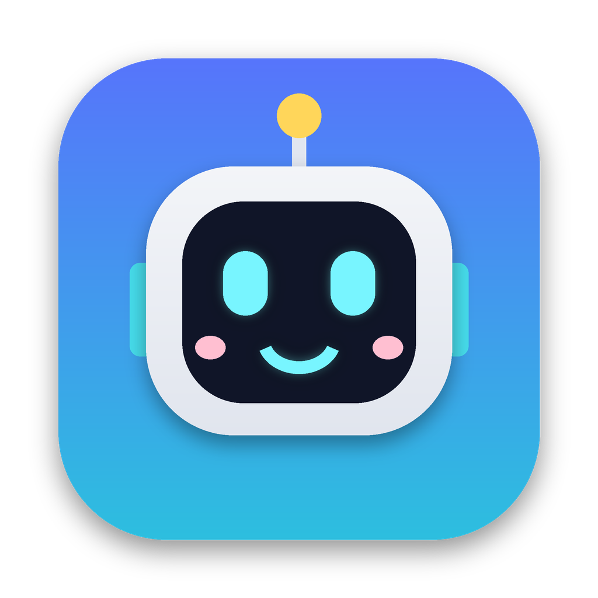

# Buddy

En liten AI-robot som sitter i hörnet av skärmen när du presenterar. Buddy lyssnar i bakgrunden, hoppar in när du säger en triggerfras ("Vad tycker du, Buddy?"), pratar svenska med en mun som rör sig i takt med rösten och drar sig tillbaka när du säger en avslutsfras ("Tack, Buddy").



## Funktioner

- Menyradsapp för macOS 13 eller senare (Apple silicon och Intel).
- Lyssnar med Apples taligenkänning, på svenska som standard.
- Flera **moment** per presentation, vart och ett med egna triggerfraser, avslutsfraser och manus.
- Två lägen per moment:
  - **AI**: Claude svarar fritt utifrån ett grovt manus och det du faktiskt säger.
  - **Manus**: Buddy säger dina repliker ordagrant, en per svar. Inget nätverk behövs för AI.
- Animerad robot med läppsynk och textning, ovanpå bildspel i helskärm.
- Röster: macOS inbyggda (gratis, fungerar offline) eller ElevenLabs.
- Reservrepliker om Claude inte svarar i tid. Fasta repliker kan renderas i förväg.
- Globala kortkommandon för att starta, tysta och avsluta Buddy.

## Installera

1. Ladda ner `Buddy.dmg` från [Releases](../../releases) och dra Buddy till Program.
2. Starta Buddy. En ikon dyker upp i menyraden (ingen ikon i Dock).
3. Tillåt mikrofon och taligenkänning när macOS frågar.

Om versionen inte är notariserad av Apple stoppar macOS den första gången. Gå då till Systeminställningar → Integritet och säkerhet och klicka på Öppna ändå.

## Kom igång

1. **Inställningar → AI**: klistra in en Anthropic API-nyckel från [console.anthropic.com](https://console.anthropic.com). Standardmodell är Claude Opus 5.5. Sonnet 5.5 och Haiku 5.5 svarar snabbare.
2. **Inställningar → Röst**: välj röst. För bäst svensk macOS-röst: Systeminställningar → Hjälpmedel → Uppläst innehåll → Systemröst → Hantera röster, och ladda ner en svensk röst i premium- eller förbättrad kvalitet.
3. **Redigera presentationer**: en exempelpresentation finns redan. Ändra triggerfraser, avslutsfraser och moment.
4. **Kontrollpanel**: skriv "Vad tycker du, Buddy?" och tryck Skicka för att testa utan mikrofon. Säg det sedan högt.

## Så fungerar en dialog

1. Buddy lyssnar efter triggerfraser.
2. När en trigger hörs dyker roboten upp och väntar på en kort paus, så att du hinner prata klart.
3. Buddy svarar. Sedan väntar den på ditt svar och svarar igen, tills
   - du säger en avslutsfras (Buddy säger hej då),
   - momentets högsta antal svar är nått,
   - det har varit tyst en stund (inställbart), eller
   - du trycker ⌃⌥⌘B.
4. Mikrofonen stängs av medan Buddy pratar, så att Buddy inte hör sig själv.

**Vilket moment startar?**

- En triggerfras som bara finns i ett moment startar just det momentet.
- En gemensam triggerfras startar nästa moment som inte är gjort, i ordning. Du kan välja nästa moment i menyn (Nästa moment).
- När alla moment är gjorda svarar Buddy kort och improviserat.
- "Börja om" i menyn nollställer alla moment, t.ex. efter en repetition.

Fraserna matchas förlåtande: versaler, skiljetecken och vanliga talspråksformer spelar ingen roll ("va tycker du baddy" räknas som "vad tycker du buddy"). Hur strikt det ska vara ställer du in under Inställningar → Lyssna.

## Kortkommandon

| Kortkommando | Gör |
|---|---|
| ⌃⌥⌘ B | Starta nästa moment nu / avsluta dialogen |
| ⌃⌥⌘ . | Tyst! Avbryt Buddys replik |
| ⌃⌥⌘ L | Slå på/av lyssnandet |

De fungerar även när presentationsprogrammet ligger överst.

## Tips inför scenen

- Repetera med samma mikrofon och högtalare som på scenen. Kontrollpanelen visar vad Buddy hör.
- Välj triggerfraser som du inte säger av misstag, och gör en kort paus efter frågan.
- Tryck "Förbered repliker" i menyn innan du går upp på scen. Fasta repliker spelas då upp direkt.
- AI-läget kräver nätverk. Manus-läget fungerar utan (taligenkänningen fungerar offline om svenska stöds på datorn).
- Har du en extern skärm eller projektor kan avataren visas på den, på alla skärmar eller bara på huvudskärmen (Inställningar → Avatar).
- Syns inte avataren över Keynote: tillåt andra appar att använda skärmen under bildspel i Keynotes inställningar, eller spela upp bildspelet i ett fönster.

## Presentationsfiler

Presentationer sparas som JSON i `~/Library/Application Support/Buddy/Sessions/` och kan importeras och exporteras i redigeraren. Se [examples/ai-foredrag.json](examples/ai-foredrag.json). Alla fält utom `name` är frivilliga.

| Fält | Betydelse |
|---|---|
| `name` | Presentationens namn |
| `buddyName`, `nameVariants` | Buddys namn och hur taligenkänningen kan stava det |
| `persona`, `context` | Vem Buddy är, och vad presentationen handlar om |
| `triggers`, `endPhrases` | Fraser som gäller alla moment |
| `farewells`, `fallbackLines` | Avskedsrepliker och reservrepliker |
| `maxWordsPerReply` | Ungefärlig längd på AI-svar |
| `moments[].title` | Momentets namn |
| `moments[].triggers`, `moments[].endPhrases` | Momentets egna fraser |
| `moments[].mode` | `"ai"` eller `"scripted"` |
| `moments[].script` | Grovt manus för AI-läget |
| `moments[].lines` | Repliker: sägs ordagrant i manusläge, reserv i AI-läge |
| `moments[].maxTurns` | Högsta antal svar (0 = tills en avslutsfras sägs) |
| `moments[].enabled` | `false` hoppar över momentet |

## Integritet

- Taligenkänningen görs av Apple, på datorn om språket stöds, annars hos Apple.
- Under en dialog skickas det du säger, och en del av det du sagt de senaste minuterna, till Anthropic (Claude). Mellan dialogerna skickas inget.
- Med ElevenLabs skickas Buddys repliker dit för att göras om till tal.
- API-nycklarna sparas i macOS nyckelring.

## Bygga från källkod

Kräver macOS 13+ och Xcode 15 eller senare.

```sh
make test   # enhetstester för kärnlogiken
make run    # bygger build/Buddy.app och startar den
make zip    # build/Buddy.zip att dela
```

Projektet är ett Swift-paket:

- `Sources/BuddyCore`: plattformsoberoende logik – frasmatchning, dialogmotor, Claude-protokoll. Testas i `Tests/BuddyCoreTests`.
- `Sources/Buddy`: macOS-appen – taligenkänning, röster, overlay med robot, menyrad, fönster.
- `scripts/build-app.sh`: bygger, signerar och paketerar `Buddy.app`.

## Dela appen med andra

Taggar som `v0.1.0` bygger en release med `Buddy.dmg` och `Buddy.zip` via GitHub Actions. För att slippa Gatekeeper-varningen behövs signering med ett Developer ID och notarisering. Lägg in dessa repository secrets så sköts det automatiskt:

| Secret | Innehåll |
|---|---|
| `MACOS_CERTIFICATE_P12` | Base64 av ett exporterat "Developer ID Application"-certifikat (.p12) |
| `MACOS_CERTIFICATE_PASSWORD` | Lösenordet till .p12-filen |
| `MACOS_SIGN_IDENTITY` | T.ex. `Developer ID Application: Namn (TEAMID)` |
| `APPLE_ID`, `APPLE_TEAM_ID` | Apple-konto och team-id |
| `APPLE_APP_PASSWORD` | Appspecifikt lösenord för notarisering |

Utan secrets byggs en osignerad (ad hoc-signerad) version.
